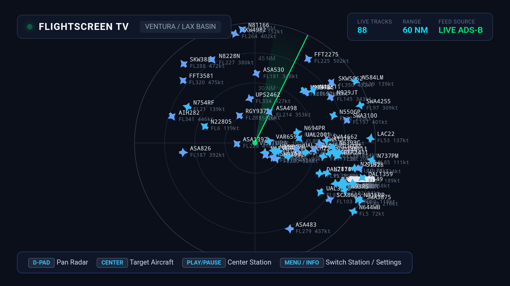
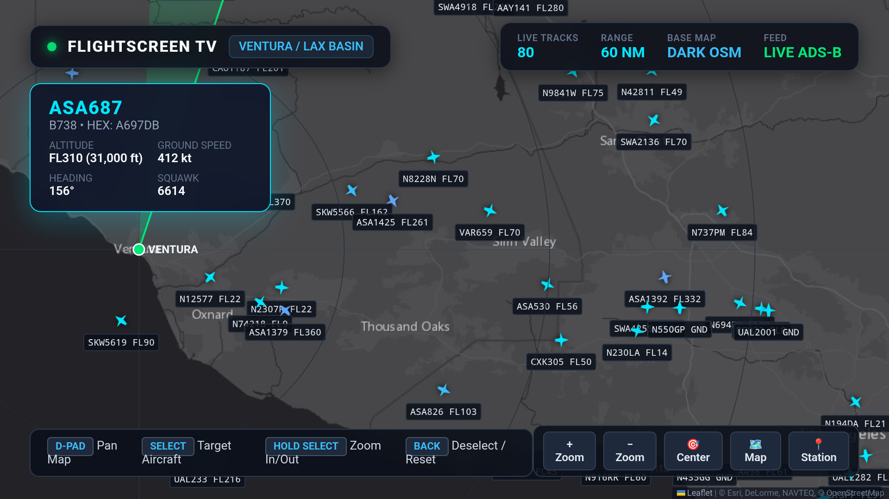
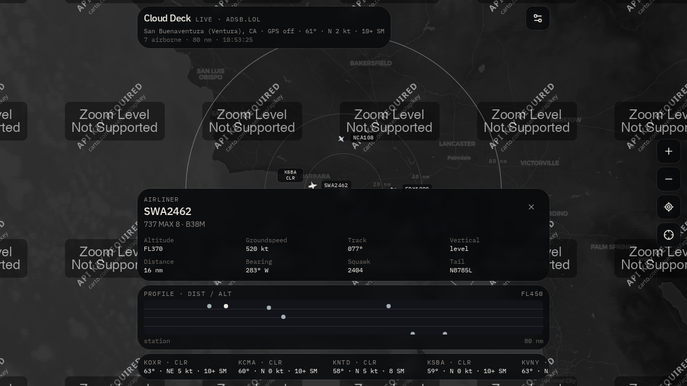
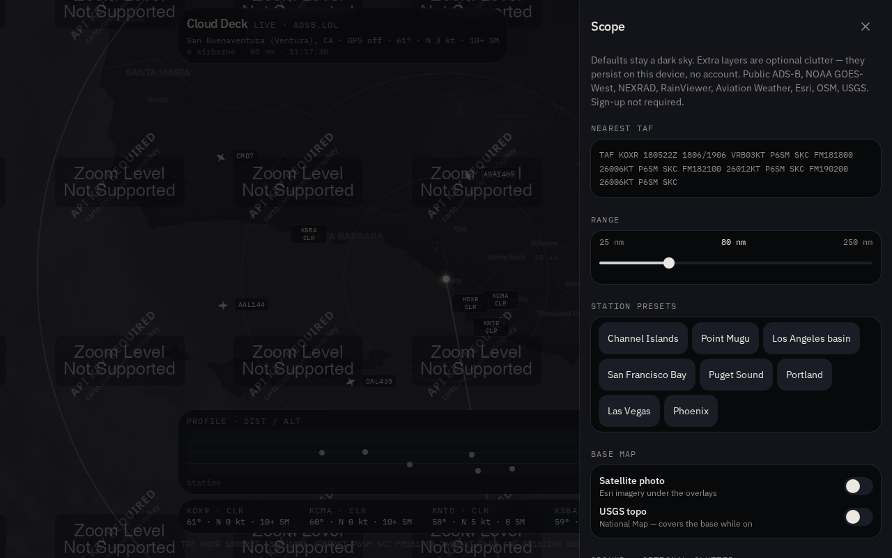

<!-- intro: Mike writes this -->
(Mike: one paragraph on why this exists.)

# FlightScreen (web and Android TV)

FlightScreen is a live flight and weather radar display for a TV or a spare screen: ADS-B aircraft tracks around a chosen station, drawn over a dark map with weather and airport data, in a web app (shown on screen as "Cloud Deck") and a sideloadable Android TV / Chromecast app ("FlightScreen TV"). It is for anyone who wants an ambient flight-tracker screen without accounts or API keys.

## Screenshots

<!-- docs/screenshots/ does not exist; these are the QA captures kept in screenshots/ -->

| | |
| --- | --- |
|  |  |
| Android TV app, standalone radar page on a Chromecast with Google TV | Android TV app, dark map with an aircraft selected |
|  |  |
| Web app with an aircraft card and the distance/altitude profile | Web app "Scope" settings: range, station presets, base map and overlays |

## What it does

- Plots live ADS-B traffic around a station: the web app polls adsb.lol (adsb.fi as fallback) every 12 seconds within a 25 to 250 nm range (default 80 nm); the Android standalone page polls adsb.lol every 18 seconds within 60 nm. No keys or sign-up.
- Station comes from browser geolocation when allowed, otherwise Ventura, CA; the web app has eight presets (Channel Islands, Point Mugu, Los Angeles basin, San Francisco Bay, Puget Sound, Portland, Las Vegas, Phoenix) plus "use the map centre"; the Android page cycles six (Ventura/LAX, SF Bay, Seattle/Tacoma, New York/JFK, Chicago O'Hare, Denver).
- Selecting an aircraft (click, tap, or the TV remote) shows type, altitude, groundspeed, track, vertical rate, distance, bearing, squawk and tail; the web app also draws a distance/altitude profile strip and can filter ground traffic, airliners, general aviation and rotorcraft by ADS-B emitter category.
- Weather in the web app: NWS observations and forecast (api.weather.gov), METAR/TAF from aviationweather.gov for the nearest fields in a built-in list of western US airports, RainViewer precipitation, GOES-West infrared clouds, and NEXRAD from the Iowa Environmental Mesonet (CONUS mosaic, nearest WSR-88D reflectivity, echo tops, MRMS). Storm-relative velocity is experimental: it depends on which products the nearest site publishes.
- Optional ground overlays in the web app: Esri satellite or USGS topo base map, Esri streets, places and hillshade, OpenRailwayMap, OpenSeaMap, county and state lines, Waymarked Trails, METAR temperature chips, and live CHP incidents and Caltrans lane closures (California only).
- Range rings, a decorative radar sweep (off when the OS asks for reduced motion), callsign labels and per-layer opacity are all toggles in the "Scope" panel; choices persist in the browser's local storage, and the on-screen chrome fades after about five seconds without input. Keyboard: Esc clears the selection, H returns to the station.
- The Android TV app is a full-screen, keep-screen-on WebView for Leanback devices (minSdk 22, targetSdk 35); the Chromecast with Google TV is the device it was tested on. By default it loads a bundled standalone radar page (Leaflet, Esri dark-grey canvas map with a satellite toggle, canvas sweep and rings); from the Menu dialog you can point it at any URL instead, such as a deployed copy of the web app or a server on your LAN.
- TV remote mapping (Chromecast with Google TV voice remote): D-pad pans; Select picks the next aircraft; holding Select opens a toolbar (zoom in/out, centre, map style, station) that Left/Right navigate and Select activates, Up or Back leaves it; Play/Pause snaps back to the station; Menu/Info opens the URL dialog; Guide or Channel Up cycles the station; Mute toggles dark map/satellite; Back clears the selection, and pressing it twice within two seconds exits.

## Run the web app

Needs Node 22 and npm (tested with Node 22.23 and npm 10.9). The dev server binds to port 8080; the production preview to 8081.

```bash
npm ci
npm run dev
```

Then open http://localhost:8080. Allow location access to centre on yourself, or pick a preset from the Scope panel (the sliders icon, top right).

Checks and the production build (the build targets Vercel through the Nitro "vercel" preset and writes to `.vercel/output`; `npm run preview` serves that output):

```bash
npm run typecheck
npm run build
npm run preview
npm run test
```

## Build and install the Android TV app

Needs a JDK (17 or newer; the CI workflow uses Temurin 17) and an Android SDK with `platforms;android-35` and `build-tools;35.0.0`, with `ANDROID_HOME` pointing at it. The Gradle wrapper downloads Gradle 8.9 itself.

```bash
sdkmanager --install "platform-tools" "platforms;android-35" "build-tools;35.0.0"
cd android
./gradlew assembleDebug --no-daemon
```

The APK lands at `android/app/build/outputs/apk/debug/app-debug.apk` (package `com.flightscreen.tv`, version 1.0.0, debug-signed). `android/scripts/gradle.sh` is the same build with the owner's local JDK and SDK paths filled in.

Sideload over the network from a computer on the same Wi-Fi (enable Developer options and Network debugging on the TV first; `android/README.md` walks through that and two app-based alternatives). This step needs a TV and was not run in this pass:

```bash
adb connect <tv-ip-address>:5555
adb install -r android/app/build/outputs/apk/debug/app-debug.apk
adb shell am start -n com.flightscreen.tv/.MainActivity
```

A prebuilt debug APK is checked in at `builds/FlightMap-DeskRadar-Chromecast-debug.apk` (byte-identical copy in `artifacts/`; `artifacts/app.apk` is a symlink to it). The GitHub Actions workflow `.github/workflows/build-apk.yml` also builds the APK on every push or pull request to `main` and keeps it as a 30-day artifact named `FlightMap-DeskRadar-Chromecast-APK`.

## Repository layout

- `src/` is the web app (TanStack Start, React 19, Leaflet, Tailwind 4): `src/routes/index.tsx` is the screen, `src/components/` the map and HUD, `src/lib/sky-data.ts` and `src/lib/road-traffic.ts` the server-side feed fetchers.
- `android/` is the Android TV app: one Java activity, a bundled `assets/index.html` radar page, and a vendored copy of Leaflet 1.9.4.
- `screenshots/` holds QA captures from the sandbox and from a Chromecast; `attachments/` holds reference material about a 3D-printed desk radar enclosure (a Printables listing and a phone photo), not used by the build.
- `.grok/`, `scripts/`, `server/`, `public/__grok/`, `startup.sh`, `migrations/auth/` and the auth, database, app-data and multiplayer helpers under `src/lib/` are the Grok App Builder scaffold the web app was created in. Sign-in and the database are switched off (`.grok/app-env.json`); the app uses neither.

## Status and limits

- Stopping point, decided 2026-10-28. The owner's attention has moved to the Apple-platform version of FlightScreen, which is not in this repository. The web and Android TV apps here are left where they stand, and no further work is planned; treat the "experimental" notes above as permanent.
- The web app's default dark base map comes from CARTO's public tile endpoint without an API key. On 2026-11-05 that endpoint returned the same "API key required / zoom level not supported" placeholder for every tile, and the repository's own screenshots show the same, so the default view has no street map under the overlays. Switching the base map to "Satellite photo" or "USGS topo" in the Scope panel gives a real base map (both tile services return normal tiles). The Android standalone page uses Esri canvas tiles and is unaffected.
- Coverage is built around the western United States: the airport list for METAR/TAF only covers California to Washington plus Nevada, Arizona, Utah and Idaho, road traffic is California only, clouds are GOES-West, and the presets are west coast plus Nevada and Arizona. Aircraft tracks work wherever adsb.lol or adsb.fi have receivers.
- Everything is fetched live from free public feeds with no caching; rate limits or outages show up as "Traffic unavailable" or "Partial" notes in the HUD rather than stale data. Ground traffic (CHP and Caltrans) is parsed from their KML feeds and breaks if those change.
- The web build is wired for Vercel through the Grok App Builder pipeline, which injects a script from grok.com ("Created with Grok" pill) and PWA metadata into every HTML response. No public deployment URL is recorded in this repository.
- The Android app is debug-signed and sideload-only; it is not on any store. Its WebView allows cleartext HTTP and file-URL cross-origin access so the bundled page can call the feeds, so only point it at servers you trust. The Chromecast screenshots are the owner's; this pass built the APK but had no TV to install it on.
- Known rough edges: `npm run test` passes 187 of 195 tests, and the 8 failures are share-card metadata tests in `scripts/grok-pwa-plugin.test.mjs`, not app code. `npm run lint` is not a gate: almost all of its reported problems come from the vendored minified Leaflet under `android/`, with a handful in the app and scaffold code.

## Licence

MIT. See [LICENSE](LICENSE).
